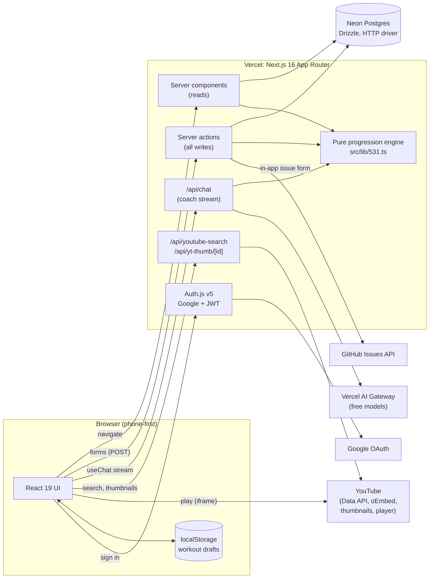
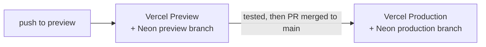

# 5/3/1 Tracker

A multi-user workout tracker built around Jim Wendler's **5/3/1**, with pyramid, reverse pyramid, straight-set, timed-set and bodyweight progressions, workout templates, a calendar and an AI coach.

**Stack:** Next.js 16 (App Router) · Neon Postgres (Drizzle) · Auth.js (Google) · Vercel AI SDK · deployed on Vercel.

📐 Design details and rationale: **[design.md](design.md)** · 🛠 Working on the repo: [CLAUDE.md](CLAUDE.md) · 🧰 Project skills: [Skills.md](Skills.md)

## Features
- **Exercise library**: default exercises every user can start from (suggested progression and sets/reps, you enter your own training max), also pickable in the template builder. Admins manage it (including how-to videos) at `/admin/catalog`; videos are copied to your exercise when you set it up.
- **Custom exercises** with a generated progression: training max (or 1RM × TM%), per-cycle increment, full block projection.
- **Reset progression** on an exercise page returns it to block 1, cycle 1, week 1 at its starting training max (history is kept).
- **Progression types** per exercise, changeable later (history is kept; the cycle position resets):
  - **5/3/1 style**, **pyramid**, **reverse pyramid**: percentage tables with a training max that rises every 3-week cycle. Jokers are 5/3/1 only.
  - **Straight sets** (sets × reps) and **timed sets** (sets × seconds): performance-driven. The weight (or target time) rises after a week only if the target was hit on at least 50% of sets.
  - **Bodyweight exercises**: weightless straight sets (reps) or timed sets (seconds), with an optional amount added to the target after each successful week.
- **Times per week** (5/3/1, pyramid, reverse pyramid): do an exercise 1-7 times a week and repeat that week's rep scheme every time before moving on to the next week.
- **Multiple 3-week cycles before a deload** (configurable per exercise). TM increases after each cycle; a deload follows the last cycle; then a new block starts.
- **Templates** (workout days) with drag-to-reorder, and a **workout timer** with per-set rest timing.
- **Target vs. actual** logging per set, a calendar of past workouts, and a progress table with an est. 1RM chart.
- **Joker sets** (per-exercise toggle): suggested in 5% steps above the top set, logged separately.
- **How-to videos**: an *Add video* button on each exercise page searches YouTube (or takes a pasted link) and embeds it as a click-to-play player with a cached thumbnail.
- **AI coach** that can estimate a training max, project a progression and add exercises (with your approval).
- **Phone-first**: installable, unfinished workouts are saved locally and survive reloads and failed saves.
- **Profiles**: each user's data is isolated; Google login; units (lb/kg) and weight rounding.

## Architecture



- Pages read through server components, and every write is a server action that runs on Vercel. Each one checks the signed-in user before making any database call and verifies ownership of every id it receives.
- The default **exercise library** (`exercise_catalog`) is the one global table: every other table is per-user. Library entries only pre-fill the new-exercise form; a user's own exercise row is created when they set it up. It is managed at `/admin/catalog` by the emails in `ADMIN_EMAILS`, checked on the server.
- **Videos** are never stored, only their YouTube id and title. Search and thumbnails go through our own routes (the search key stays server-side; thumbnails are served with an immutable cache header), and YouTube's player loads only when play is pressed.
- All progression math is in one **pure engine** (`src/lib/531.ts`), shared by the UI, server actions and the coach, and covered by unit tests.
- Environments: pushes to `preview` deploy to a preview site backed by a persistent Neon **preview** branch; merging a PR to `main` deploys to production on the Neon **production** branch.



### Key decisions
| Decision | Why |
|---|---|
| Server components and server actions instead of a data API | Pages read the database on the server and every write is a server action, so there is no REST/GraphQL layer for exercises, workouts or templates to build and secure. The few API routes that exist (coach chat, video search, thumbnails, sign-in) serve streaming and external services, not app data. The signed-in user is checked in one place before any database call. |
| No static caching or ISR for pages | Every page is per-user data, so there is nothing shareable to cache. The one exception is YouTube thumbnails, which are identical for everyone and are cached at the CDN and browser (see the video decision below). |
| Neon HTTP driver with `db.batch` | Serverless friendly; atomic multi-statement writes without interactive transactions. |
| One pure progression engine | A single source of truth for UI, writes and coach; easy to test. |
| Workouts snapshot TM, cycle and week | History stays correct when an exercise is edited or changes progression type. |
| Archive, never delete | Keeps history, calendar and progress data intact. |
| Performance-driven straight and timed sets | Weight or target only rises when it is earned. |
| Google-only sign-in with JWT sessions | No passwords or session table; our own `users.id` is the stable key. |
| Separate Neon branches for preview and production | Safe testing; production schema changes are additive and ship only with the PR that needs them. |
| Default exercises are a library, not copied rows | Each user's exercise needs their own training max, so the library only pre-fills the form (and the template builder asks for the max inline). No half-configured exercises, nothing to keep in sync. |
| Admin access by `ADMIN_EMAILS`, checked in every library action | Keeps the admin email out of the repo; the page and each server action refuse everyone else. |
| YouTube videos: embed, never store; thumbnail first | Cached thumbnails make pages light; the ~1 MB player loads only on play. Search runs server-side so the API key stays secret, and pasted links work without a key. |
| Optional times per week for 5/3/1-type progressions | Repeat the same week's scheme on every session that week before moving on. |
| Confirm before archiving; archived exercises can be restored; progression can be reset | Destructive-looking actions are reversible and history is always kept. |
| Coach uses free models, math done in code | No model cost, no hallucinated numbers; adding an exercise needs explicit approval. |
| Local workout drafts, no service worker | Workouts survive bad signal without the complexity of offline sync. |

The full list, the data model (ER diagram), the progression state machine and the workout sequence diagram are in **[design.md](design.md)**.

## Potential architecture improvements
Ideas that are not built yet, with the trade-offs to settle first.

### 1. Keep in-progress workouts in a cache instead of Postgres
Today an unfinished workout is autosaved to `localStorage` and also upserted into the `workout_drafts` table, so every autosave is a database write. A low-latency store (Redis, for example Upstash through the Vercel Marketplace) could hold the draft instead, and Postgres would only be written once, when the workout is completed.
- **Gains:** far fewer database writes and round trips on a phone with a flaky connection; the draft is still available from another device, and expiry is built in (a TTL replaces the 36-hour cleanup).
- **Costs and risks:** another service to provision, secure and pay for; drafts become volatile (an eviction or outage loses an unfinished workout, so `localStorage` stays as the fallback); the stale-submission guard in `completeSession` and the draft keys must keep working unchanged.
- **Open question:** whether the extra moving part is worth it at the current scale, since the existing drafts are small, per-user upserts. Measuring the autosave write rate first would show the real benefit.

### 2. Coach creates workout templates from your goals
Let the coach propose, and optionally create, templates from stated goals, days per week, equipment and so on. Today the coach can only read your exercise list and add an exercise after you approve it, so this means giving the agent more power over the database. That changes the security model, and it should be designed before it is built:
- **No credentials for the agent.** The model never sees a connection string or SQL. It only calls a small set of typed tools (for example `proposeTemplate`) that run in our server code.
- **Identity comes from the session.** The `userId` is bound by the server when the tools are created; the model can never choose or change it. Every id the model supplies (an exercise, a template) is verified to belong to that user, exactly as the server actions do now.
- **Propose, then approve.** The model returns a structured plan. Nothing is written until you review it and confirm in the UI, as `addExercise` already requires. Approved plans are written by the same validated server actions the forms use (zod schemas, the per-user exercise limit), never by raw model output.
- **Prompt injection.** Anything user-controlled that reaches the model (exercise names, template names, issue text, pasted notes) is untrusted input. Tool arguments are validated and size-limited, tools are least-privilege (no delete or update-anything tools), and a model that is tricked can at worst produce a proposal you decline.
- **Abuse limits.** Per-user rate limits and daily caps on proposals, plus logging of tool calls for review.
- **Models.** Planning is harder than naming an exercise, so the zero-cost model constraint may need revisiting. Structured output with a schema keeps the result checkable.

### 3. Speed up the coach's next-progression suggestion
The suggestion is slow because it waits for a reasoning model on the free tier (up to a 45 s timeout and a 4,000-token output budget, since thinking tokens count against it) inside the request that renders the page. Options, roughly in order of effort:
1. **Cache by name.** Store the answer (per normalised exercise name, shared across users) so each exercise is only ever asked once. Most bodyweight progressions repeat across users.
2. **Seed common answers.** Add a suggested next progression to the exercise library for the common movements, so no model call is needed for them. The model is only the fallback for custom names.
3. **Cheaper call.** Turn reasoning off, shorten the prompt and cap the output at a few dozen tokens, since the reply is one exercise name. Check the free model catalog for a faster non-reasoning model (`npm run check:models` keeps it zero-priced).
4. **Do it off the critical path.** Return the page immediately and fill the suggestion in afterwards (a server action started after the redirect, or a small client fetch with a loading state), so the user never waits on the model.
5. **Race the models.** Start the fallback model after a short delay instead of waiting for the first to fail.

### 4. Import existing exercise data (CSV)
Let users bring their history from a spreadsheet or another app. Design points:
- **Two levels.** Exercises and current training maxes are simple. Past workouts and sets need more: each workout snapshots the training max, block, cycle and week, which a generic export does not have, so imported history would need a mapping step (or be stored as plain logged sets without a cycle position).
- **Safe by default.** Upload, parse and validate on the server with the same zod schemas as the forms, show a dry-run preview with row-level errors, and only write on confirmation. Writes go through `db.batch` so an import is all-or-nothing.
- **Idempotency and limits.** Detect duplicates (by name and date) so re-importing does not double up; cap file size and rows; respect the 60-exercises-per-user limit.
- **Formats.** Start with one documented template CSV; mappings for common exports (Strong, Hevy and similar) can come later.

### 5. Bulk creation of exercises (CSV or pasted table)
A smaller cousin of the import: create many exercises at once, for example when moving from another program. One row per exercise with name, type, progression, training max, increment, sets, reps and times per week.
- Reuse `insertExercise` and the existing validation so rows behave exactly like the form, and report errors per row with a downloadable corrected file.
- Run a dry-run preview first and create everything in one batch.
- Offer a downloadable template, and the option to add the new exercises to a workout template in the same step.
- Interacts with the exercise library: an uploaded row that matches a library name can inherit the library's suggested progression and videos.

## Setup
```bash
nvm use            # Node 26 (see .nvmrc; Next 16 and the AI SDK need Node >= 22)
npm install
cp .env.example .env.local
```
1. **Neon**: `vercel link && vercel integration add neon`, then `vercel env pull .env.local` (provides `DATABASE_URL`).
2. **Google OAuth**: Google Cloud Console → Credentials → OAuth client (Web). Authorized redirect URIs:
   `http://localhost:3000/api/auth/callback/google` and `https://<your-domain>/api/auth/callback/google`.
   Set `AUTH_GOOGLE_ID` / `AUTH_GOOGLE_SECRET`.
3. `npx auth secret` → `AUTH_SECRET`.
4. `npm run db:push` to create tables.
5. `npm run dev`.

Optional env vars: `ADMIN_EMAILS` (comma-separated emails that can manage the exercise library at `/admin/catalog`) and `YOUTUBE_API_KEY` (YouTube Data API v3, enables video search; pasted links work without it).

Add the same env vars in Vercel (Project → Settings → Environment Variables) and `vercel deploy`.

## Progression rules
5/3/1 weeks: 65/75/85×5+, 70/80/90×3+, 75/85/95×5/3/1+, deload 40/50/60×5. Jokers continue at +5% steps past the top set. The other types and the exact rules for training max, deloads and bodyweight progressions are in [design.md](design.md#progression-engine).

## Development
```bash
npm run dev          # local dev server
npm test             # progression engine tests
npm run lint
npx tsc --noEmit
npm run build
```
