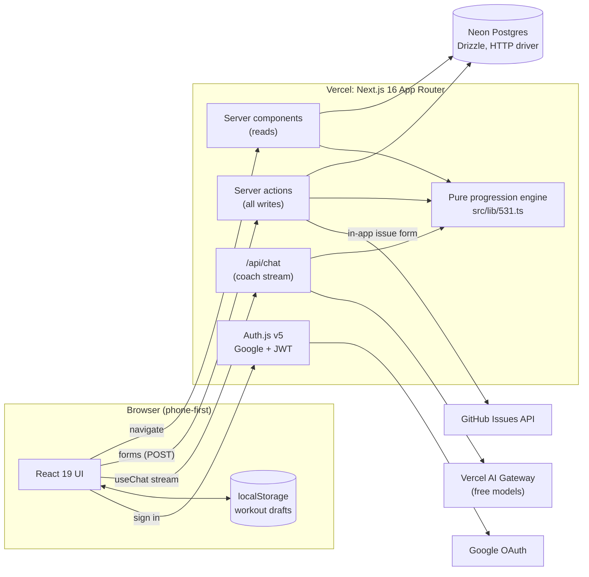
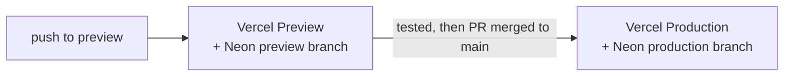

# 5/3/1 Tracker

A multi-user workout tracker built around Jim Wendler's **5/3/1**, with pyramid, reverse pyramid, straight-set, timed-set and bodyweight progressions, workout templates, a calendar and an AI coach.

**Stack:** Next.js 16 (App Router) · Neon Postgres (Drizzle) · Auth.js (Google) · Vercel AI SDK · deployed on Vercel.

📐 Design details and rationale: **[design.md](design.md)** · 🛠 Working on the repo: [CLAUDE.md](CLAUDE.md)

## Features
- **Custom exercises** with a generated progression: training max (or 1RM × TM%), per-cycle increment, full block projection.
- **Progression types** per exercise, changeable later (history is kept; the cycle position resets):
  - **5/3/1 style**, **pyramid**, **reverse pyramid**: percentage tables with a training max that rises every 3-week cycle. Jokers are 5/3/1 only.
  - **Straight sets** (sets × reps) and **timed sets** (sets × seconds): performance-driven. The weight (or target time) rises after a week only if the target was hit on at least 50% of sets.
  - **Bodyweight exercises**: weightless straight sets (reps) or timed sets (seconds), with an optional amount added to the target after each successful week.
- **Multiple 3-week cycles before a deload** (configurable per exercise). TM increases after each cycle; a deload follows the last cycle; then a new block starts.
- **Templates** (workout days) with drag-to-reorder, and a **workout timer** with per-set rest timing.
- **Target vs. actual** logging per set, a calendar of past workouts, and a progress table with an est. 1RM chart.
- **Joker sets** (per-exercise toggle): suggested in 5% steps above the top set, logged separately.
- **AI coach** that can estimate a training max, project a progression and add exercises (with your approval).
- **Phone-first**: installable, unfinished workouts are saved locally and survive reloads and failed saves.
- **Profiles**: each user's data is isolated; Google login; units (lb/kg) and weight rounding.

## Architecture



- The **browser never talks to the database**. Pages read through server components; every write is a server action that runs on Vercel, checks the signed-in user and verifies ownership of every id it receives.
- All progression math is in one **pure engine** (`src/lib/531.ts`), shared by the UI, server actions and the coach, and covered by unit tests.
- Environments: pushes to `preview` deploy to a preview site backed by a persistent Neon **preview** branch; merging a PR to `main` deploys to production on the Neon **production** branch.



### Key decisions
| Decision | Why |
|---|---|
| Server components and server actions, no separate API | Fewer moving parts; the database is only reachable from server code. |
| No static caching or ISR | Every page is per-user data, so there is nothing shareable to cache. |
| Neon HTTP driver with `db.batch` | Serverless friendly; atomic multi-statement writes without interactive transactions. |
| One pure progression engine | A single source of truth for UI, writes and coach; easy to test. |
| Workouts snapshot TM, cycle and week | History stays correct when an exercise is edited or changes progression type. |
| Archive, never delete | Keeps history, calendar and progress data intact. |
| Performance-driven straight and timed sets | Weight or target only rises when it is earned. |
| Google-only sign-in with JWT sessions | No passwords or session table; our own `users.id` is the stable key. |
| Separate Neon branches for preview and production | Safe testing; production schema changes are additive and ship only with the PR that needs them. |
| Coach uses free models, math done in code | No model cost, no hallucinated numbers; adding an exercise needs explicit approval. |
| Local workout drafts, no service worker | Workouts survive bad signal without the complexity of offline sync. |

The full list, the data model (ER diagram), the progression state machine and the workout sequence diagram are in **[design.md](design.md)**.

## Setup
```bash
nvm use            # Node 26 (see .nvmrc; Next 16 and the AI SDK need Node >= 22)
npm install
cp .env.example .env.local
```
1. **Neon**: `vercel link && vercel integration add neon`, then `vercel env pull .env.local` (provides `DATABASE_URL`).
2. **Google OAuth**: Google Cloud Console → Credentials → OAuth client (Web). Authorized redirect URIs:
   `http://localhost:3000/api/auth/callback/google` and `https://<your-domain>/api/auth/callback/google`.
   Set `AUTH_GOOGLE_ID` / `AUTH_GOOGLE_SECRET`.
3. `npx auth secret` → `AUTH_SECRET`.
4. `npm run db:push` to create tables.
5. `npm run dev`.

Add the same env vars in Vercel (Project → Settings → Environment Variables) and `vercel deploy`.

## Progression rules
5/3/1 weeks: 65/75/85×5+, 70/80/90×3+, 75/85/95×5/3/1+, deload 40/50/60×5. Jokers continue at +5% steps past the top set. The other types and the exact rules for training max, deloads and bodyweight progressions are in [design.md](design.md#progression-engine).

## Development
```bash
npm run dev          # local dev server
npm test             # progression engine tests
npm run lint
npx tsc --noEmit
npm run build
```
