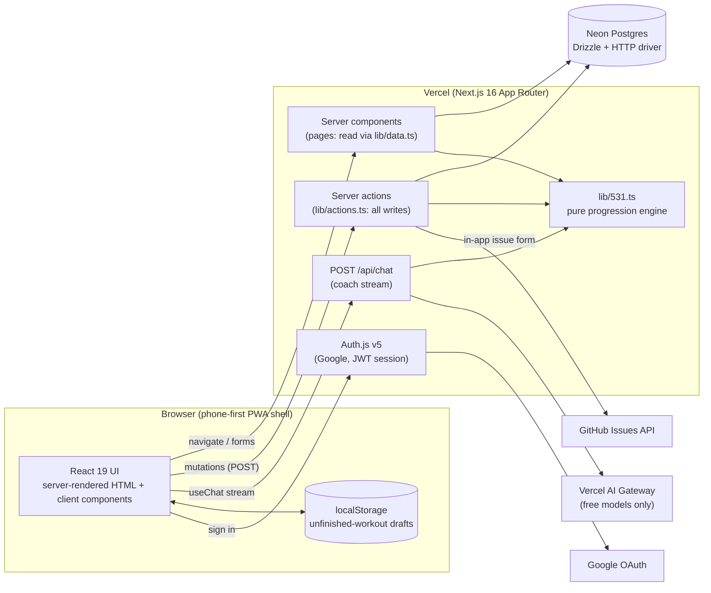
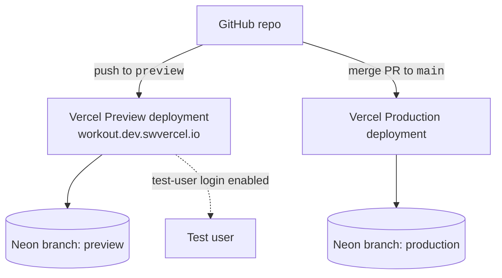
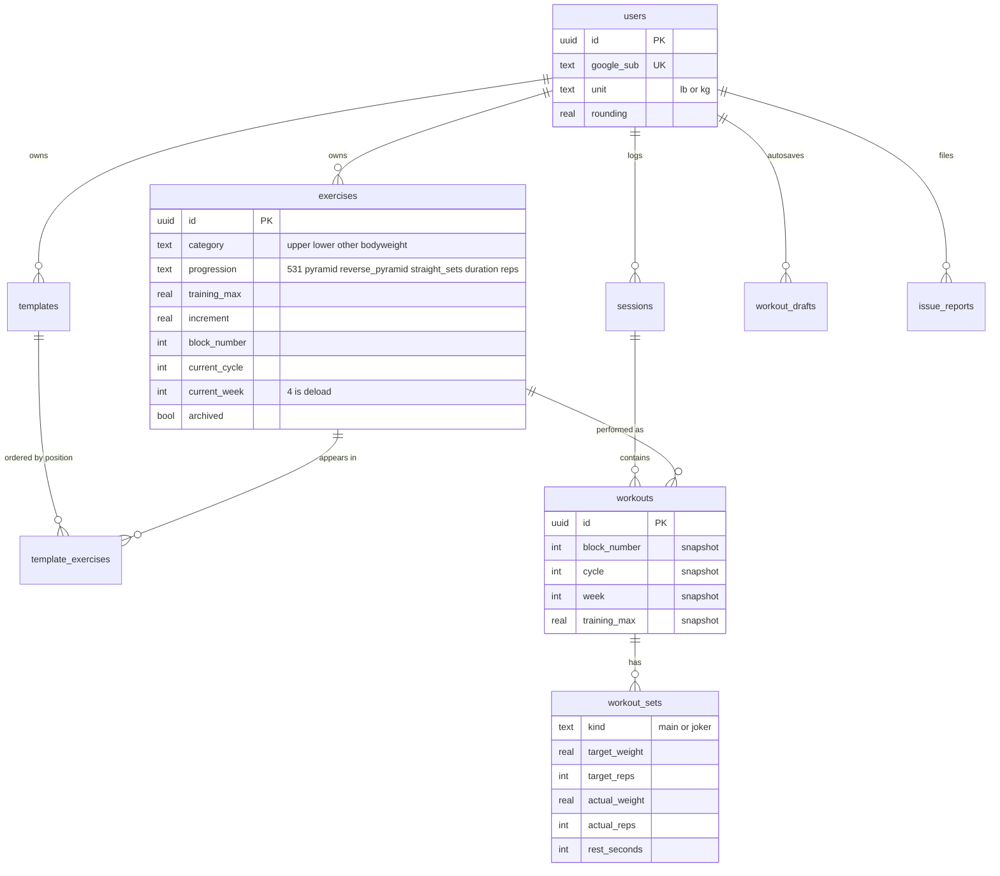
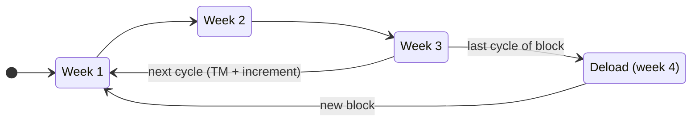
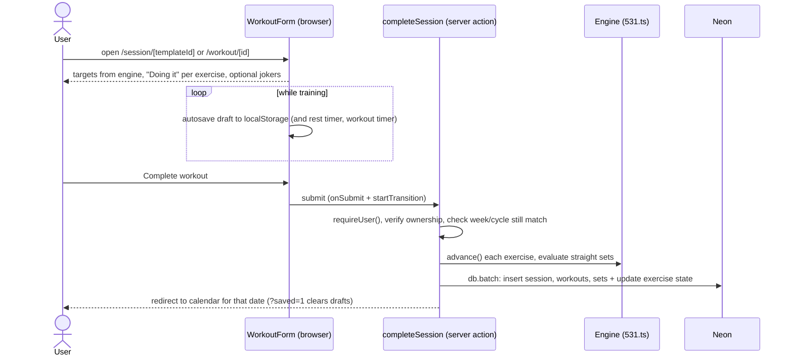
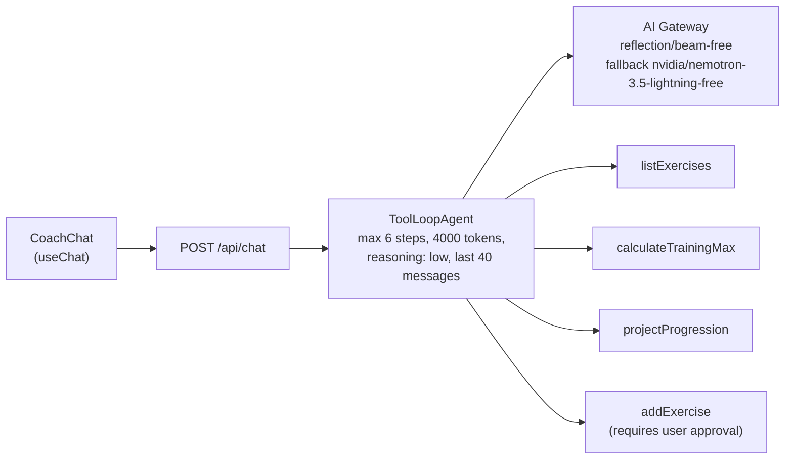

# 5/3/1 Tracker: Design & Architecture

> What the app is, how it is put together, and why. For how to *work* on it (commands, push procedure, testing, workflow rules) see [CLAUDE.md](CLAUDE.md). For setup and a quick overview see [README.md](README.md).

**Contents**
[Overview](#overview) · [Architecture](#architecture) · [Tech stack](#tech-stack) · [Code layout](#code-layout) · [Data model](#data-model) · [Progression engine](#progression-engine) · [Workout flow](#workout-flow) · [AI coach](#ai-coach) · [Authentication](#authentication) · [Databases and environments](#databases-and-environments) · [Mobile](#mobile) · [Conventions](#conventions) · [Key decisions](#key-decisions)

---

## Overview

A multi-user workout tracker built around Jim Wendler's **5/3/1**, plus pyramid, reverse pyramid, straight-set, timed-set and bodyweight progressions. Users define exercises, group them into **templates** (workout days), log **target vs. actual** sets, and watch their training max advance automatically. A **calendar** shows history and an **AI coach** answers questions and can add exercises.

| | |
|---|---|
| **Users** | Many; each user's data is fully isolated. Sign-in is Google only. |
| **Rendering** | Every page is per-user and server-rendered on demand (no static or cached pages). |
| **Backend** | None separate: Next.js server components and server actions run on Vercel and talk to Postgres. |
| **Primary device** | Phones, used mid-workout (see [Mobile](#mobile)). |

---

## Architecture



Reads happen in server components, writes in server actions, and the browser never talks to the database. Both reads and writes call the **pure** progression engine so the numbers a user sees and the numbers that get saved cannot drift apart.



---

## Tech stack

| Layer | Choice | Notes |
|---|---|---|
| Framework | **Next.js 16** (App Router, React 19, Tailwind 4) | This Next.js differs from older versions: read `node_modules/next/dist/docs/` before using unfamiliar APIs. `params` and `searchParams` are Promises. `cacheComponents` is intentionally **off** because every page is per-user dynamic. |
| Database | **Neon Postgres** via **Drizzle ORM** + `@neondatabase/serverless` | HTTP driver, so there are **no interactive transactions**; use `db.batch([...])` for atomic multi-statement writes. |
| Auth | **Auth.js v5** (`next-auth@beta`), Google only, JWT sessions | `src/auth.ts` upserts a `users` row on first sign-in and stores our own `users.id` in the token. Requires a verified Google email. |
| AI | **Vercel AI SDK 7** (`ai`, `@ai-sdk/react`) through **Vercel AI Gateway** | Plain `provider/model` strings. Only zero-priced models are used. |
| Runtime | **Node 26** (`.nvmrc`) | Next 16 and the AI SDK need Node >= 22. |
| Hosting | **Vercel**, deployed via the GitHub integration | Project `swvercel/calisthenics-tracker`. |

---

## Code layout

```text
src/
├── auth.ts                    Auth.js config (Google, JWT, user upsert, test-user provider)
├── db/
│   ├── schema.ts              Drizzle schema
│   └── index.ts               Neon client
├── lib/
│   ├── 531.ts                 PURE progression engine (schemes, advance, projection, jokers, straight-set rule)
│   ├── 531.test.ts            engine tests (vitest)
│   ├── data.ts                read queries, all scoped by userId; requireUser()
│   ├── actions.ts             "use server" actions (exercise/template/profile CRUD, completeSession, coach helpers)
│   ├── exercises.ts           insertExercise(): shared by the form-adjacent code and the coach tool
│   ├── session.ts             Exercise -> SessionExercise view model for the workout form
│   ├── format.ts              number / seconds / set formatting (fmtSetValue, fmtSeconds, ...)
│   └── testLogin.ts           gate for the non-production test-user provider
├── ai/                        coach agent, system prompt, models, next-progression suggester
├── app/
│   ├── api/chat/route.ts      coach streaming endpoint (auth required)
│   ├── issues/page.tsx        in-app issue form -> GitHub issue + issue_reports row
│   └── */page.tsx             dashboard, exercises, templates, session/[templateId], workout/[id],
│                              calendar, progress, coach, settings
└── components/                AppShell/Nav, ExerciseForm, ProgressionFields, WorkoutForm,
                               TemplateForm, CycleProgress, ProgressChart, CoachChat
scripts/
├── check-free-models.ts       verifies the coach's models are still priced at 0
└── smoke-live.sh              post-push smoke test of the live preview
```

Pages use `<AppShell>{(user) => ...}</AppShell>`, a render-prop that calls `requireUser()` and renders the nav. Unauthenticated visitors are redirected to `/`.

---

## Data model



| Table | Purpose |
|---|---|
| `users` | `google_sub` (unique), email, name, image, `unit` (lb\|kg), `rounding` (weight rounding increment). |
| `exercises` | Per-user. `category`, `progression`, `training_max`, `starting_tm`, `increment`, `cycles_per_block`, position (`block_number`, `current_cycle`, `current_week` where **4 = deload**), `jokers_enabled`, `set_count` / `rep_target` (straight sets, duration, bodyweight; for duration `rep_target` is target **seconds**), `duration_increment` (amount added to the target after a successful week: seconds, or reps for weightless straight sets), `next_progression` (legacy bodyweight), `archived`. |
| `templates`, `template_exercises` | Named groups of exercises, ordered by `position`. |
| `sessions` | One training day (optionally from a template), `performed_on` date, `duration_seconds` from the workout timer. |
| `workouts` | One exercise within a session. **Snapshots** `block_number`, `cycle`, `week` and `training_max` at the time it was done. |
| `workout_sets` | `kind` (main\|joker), target weight/reps, `is_amrap`, actual weight/reps, `rest_seconds` (rest chosen after the set; null if none). |
| `workout_drafts` | The autosaved in-progress workout (server-side copy of the browser draft). |
| `issue_reports` | Rows created by the in-app issue form, alongside the GitHub issue. |

**Design rules**

- **Nothing is deleted.** Users *archive* exercises (`archived = true`) so history stays intact.
- **History is self-contained.** Workouts snapshot their own training max and position, so editing or re-typing an exercise never rewrites the past.
- **Changing progression type** (edit form, including to/from bodyweight) keeps all logged workouts, resets `block_number` / `current_cycle` / `current_week` to 1/1/1, sets `starting_tm` and `training_max` to the entered value, and applies the form's sets/reps/increment. Moving to bodyweight zeroes TM and increment.
- **Every query is scoped by `userId`**, and server actions verify ownership of any id received from the client.
- **Schema changes** are additive where possible (nullable or defaulted columns; no drops, renames or type changes). See [Databases and environments](#databases-and-environments).

---

## Progression engine

All of it lives in `src/lib/531.ts` as **pure functions** (no I/O), covered by `src/lib/531.test.ts`.

**Shared cycle structure (all weighted types):** 3 build weeks, then after `cycles_per_block` cycles a deload week (week 4), then a new block begins.



| Type | Scheme | How the weight moves |
|---|---|---|
| **5/3/1** | 65/75/85 ×5+, 70/80/90 ×3+, 75/85/95 ×5/3/1+, deload 40/50/60 ×5 | TM rises by `increment` after each 3-week cycle. Joker sets (5/3/1 only) are suggested in +5% steps above the top set. |
| **Pyramid / reverse pyramid** | Fixed percentage tables per week | TM rises per cycle like 5/3/1. |
| **Straight sets** | sets × reps (default 5×5) at the working weight (`training_max`), deload at 60% | **Performance-driven**, no automatic bump: after a non-deload week the weight rises by `increment` only if the target reps were hit (at the target weight or heavier) on **>= 50% of sets** (`evaluateStraightSets`). |
| **Duration (timed sets)** | Same as straight sets, but `rep_target` and every set's reps are **seconds** | After a successful week the weight rises (if weighted) and the target rises by `duration_increment` (if set). Weight is optional: `training_max = 0` means no weight. |
| **Bodyweight** | Weightless straight sets or duration (`category = bodyweight`, `training_max = 0`, `increment = 0`) | Only the target grows (`duration_increment` doubles as reps or seconds added). Offered as the only two types for bodyweight in the form; the coach's `addExercise` creates weightless straight sets. |
| **Legacy "just reps"** | `progression = reps`: no weights, TM, schedule or cycle tracking | The user decides when to move on; `moveToNextProgression` archives the old exercise, creates the next variation and swaps it into templates. No new ones are created, but existing ones keep working and can be edited into the types above. |

`isStraightLike()` groups straight sets and duration; `isWeightless()` identifies straight-like exercises with no weight. Format timed values with `fmtSeconds` / `fmtSetValue`.

**Rounding and estimates**

- Always call `effectiveRounding(user.rounding, ex.increment)` (not `user.rounding` directly) for an exercise's weights, so increases finer than the profile rounding (e.g. +0.5 with rounding 5) are not rounded away.
- All weights go through `roundWeight(value, rounding)`.
- 1RM estimates use **Epley**.

---

## Workout flow



`/session/[templateId]` and `/workout/[id]` render `WorkoutForm` (one block per exercise, a "Doing it" checkbox, optional jokers). `completeSession` validates ownership and that the submitted week/cycle still matches (a **stale / double-submit guard**, not applied to legacy bodyweight), then writes everything in **one** `db.batch` so a workout and its progression change are atomic.

---

## AI coach



- **Endpoint:** `/coach` (client `CoachChat`, `useChat`) calls `POST /api/chat`, which uses `createAgentUIStreamResponse` with a per-request `ToolLoopAgent` (`src/ai/coach.ts`).
- **Prompt:** `COACH_PROMPT` in `src/ai/prompt.ts`, **kept verbatim from the product requirements (typos included)**, followed by tool-usage notes.
- **Deterministic math in code, not the LLM:** `calculateTrainingMax` and `projectProgression` call the same engine the app uses.
- **Human in the loop:** `addExercise` requires approval (`toolApproval`); the UI shows an *Add it / Cancel* card.
- **Free models only** (`src/ai/models.ts`). Avoid `reflection/beam` (price varies by provider); `npm run check:models` guards this. Free models have no data-retention guarantees, so sensitive data stays out of prompts.
- **Reasoning-model caveat:** thinking tokens count against `maxOutputTokens`; a low cap yields an empty answer (`finishReason: "length"`). Keep the cap high and `reasoning: "low"`.
- `src/ai/suggest.ts` asks the same models for the next harder variation of a legacy bodyweight exercise (e.g. Pike HSPU → Elevated pike HSPU); used by the exercise form ("Ask coach") and the exercise page.
- AI Gateway auth is automatic via the Vercel OIDC token; the team has a card on file, so the coach works.

---

## Authentication

- **Google only**, **JWT sessions** (no session table). `src/auth.ts` upserts a `users` row on first sign-in and puts our own `users.id` in the token as `session.user.id`. A verified Google email is required.
- **Test-user provider** (non-production only): a Credentials provider `test-user` (`src/auth.ts`, `src/lib/testLogin.ts`), shown on the landing page only when `testLoginEnabled()`: `ENABLE_TEST_LOGIN === "true"`, `TEST_USER_PASSWORD` set, **and** `VERCEL_ENV !== "production"`. It is refused in Production even if the flag is wrongly set.
- The test user is a normal `users` row (`google_sub = local-test-user`, email `test-user@example.invalid`) in whichever database the deployment uses (the Neon preview branch). This lets automated smoke tests sign in without a Google account.

---

## Databases and environments

| Environment | Vercel env | Neon branch | Test login |
|---|---|---|---|
| **Production** | Production | `production` | disabled |
| **Preview** | Preview (`workout.dev.swvercel.io`) | `preview` (persistent) | enabled |

- `DATABASE_URL` is set separately per Vercel environment, so preview deployments and local dev against the preview branch never touch production data.
- Production receives a schema change **only** as part of creating/merging the PR from `preview` that requires it; the schema is applied before the code that uses it is deployed.
- The preview branch can drift from production; it can be reset from production in the Neon console (this discards its data).
- Operational steps (connection strings, the push procedure, approvals) live in [CLAUDE.md](CLAUDE.md).

---

## Mobile

Workouts happen on a phone in the gym, so the UI is phone-first.

- **Inputs:** `.input` is 16px below `sm` (iOS zooms smaller fields); `.btn` / `.btn-ghost` / `.btn-icon` are 44px tall on phones; weight and rep fields set `inputMode`.
- **Navigation:** `Nav` shows links from `md` up. Below that, `BottomNav` (fixed tab bar + "More" sheet) is used, with `pb-28` on `<main>` and `.safe-bottom` for the home indicator. The viewport uses `viewport-fit=cover`.
- **Workout form resilience:** `WorkoutForm` saves an unfinished workout to `localStorage` (`wf:` keys, 36 h expiry) with a Restore/Discard banner, shows an offline banner, and keeps entries on a failed save (it submits via `onSubmit` + `startTransition`, not `<form action>`, which would reset the fields). `ClearWorkoutDrafts` clears drafts after a save.
- **Templates:** reordering uses pointer-event dragging (works on touch) plus up/down buttons; native HTML5 drag and drop is not used.
- **Calendar:** dots on phones and exercise chips from `sm`; wide tables have stacked-card versions for phones.
- **PWA:** `src/app/manifest.ts` and generated icons at `/pwa-icon/[size]` (180, 192, 512). There is **no service worker**, so no offline loading and no offline submit queue.

---

## Conventions

- Every query is scoped by `userId`; server actions call `requireUser()` first.
- Mutating server actions call `revalidatePath("/", "layout")` and then `redirect(...)`. (`revalidatePath` clears the client router cache; it is not ISR.)
- Calendar months and "today" use **UTC on the server**; the workout form defaults its date to the browser's local date.
- Don't write AI SDK code from memory: check `node_modules/ai/docs/` (v7 differs from older versions, e.g. `isStepCount`, `toolApproval`, `createAgentUIStreamResponse({ uiMessages })`).
- Tailwind component classes (`.card`, `.btn`, `.btn-ghost`, `.input`, `.label`, `.th`, `.td`) live in `src/app/globals.css`.

---

## Key decisions

| # | Decision | Why |
|---|---|---|
| 1 | **Server actions + server components, no separate API** | Fewer moving parts; the browser never touches the database; ownership checks live in one place. |
| 2 | **No static caching or ISR** (`cacheComponents` off) | Every page is per-user data; there is nothing shareable to cache. |
| 3 | **Neon HTTP driver + `db.batch`** | Works well with serverless; atomic multi-statement writes without interactive transactions. |
| 4 | **Pure progression engine** | One source of truth for the UI, server actions and the coach; trivially unit-testable. |
| 5 | **Workouts snapshot TM, cycle and week** | History is stable even when an exercise is edited or changes progression type. |
| 6 | **Archive, never delete** | Preserves history and calendar/progress data. |
| 7 | **Performance-driven straight/timed sets** | Weight or target only rises when the user earns it (>= 50% of sets hit). |
| 8 | **One shared cycle/deload structure for all types** | Calendar, block tracking and progress views work identically for every progression. |
| 9 | **Google-only auth + JWT sessions** | No password handling and no session table; our own `users.id` is the stable key. |
| 10 | **Two Neon branches (production, preview)** | Safe testing against realistic data; production schema changes ship only with the PR that needs them, and are additive. |
| 11 | **Test-user login, non-production only** | Lets smoke tests sign in without Google; hard-refused in Production. |
| 12 | **Coach uses free models only; deterministic math in code** | Zero model cost, and numbers are never hallucinated; `addExercise` needs explicit approval. |
| 13 | **Phone-first UI with local drafts** | Workouts happen on a phone with unreliable signal; unfinished sessions survive reloads and failed saves. |
| 14 | **No service worker** | Keeps deploys simple; offline loading and submit queues are out of scope. |
